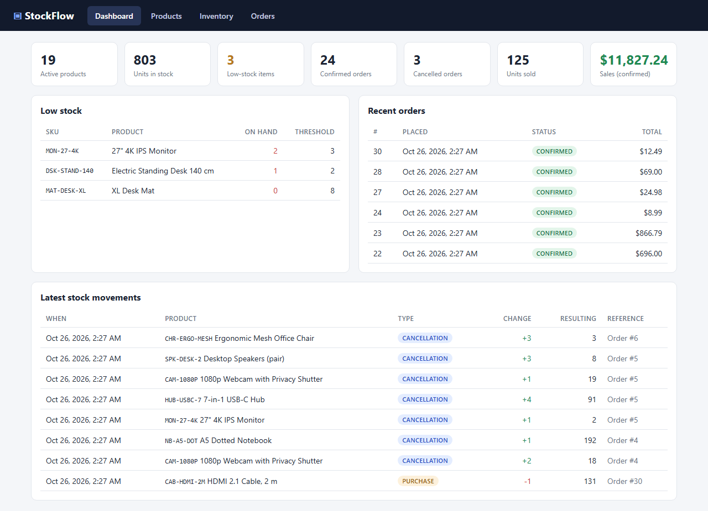

# StockFlow

[](https://github.com/deveshgoreja/stockflow/actions/workflows/ci.yml)

An inventory and order management system that stays correct when many requests hit it at once.
Built with FastAPI, PostgreSQL and React.



## Why it's not just CRUD

The hard part of inventory software is correctness under pressure, and every case below is covered
by an automated test against a real PostgreSQL database:

- **100 people buy the last unit at the same moment.** Exactly one succeeds; the other 99 get a
  clean "out of stock" error. Stock never goes negative.
- **Orders for overlapping products arrive at once.** No deadlocks, because every transaction locks
  rows in the same order.
- **A customer double-clicks "Place order".** An idempotency key makes sure only one order is
  created, even when the duplicates arrive in parallel.
- **Twenty cancel requests race for the same order.** Stock is restored exactly once.
- **Something crashes half-way through an order.** Everything rolls back: no partial order and no
  lost stock.

**101 tests pass**, including 8 concurrency tests that fire real parallel HTTP requests at a live
server. To prove the tests catch real bugs, I removed the database row lock and re-ran them:
10 of 100 buyers "bought" the single unit, and the suite failed.

## Features

- **Products:** create, edit, search and filter; unique SKUs; prices stored as exact decimals.
- **Inventory:** restocks, adjustments (e.g. damaged goods) and low-stock alerts.
- **Orders:** multi-item and all-or-nothing; prices are locked in at purchase time.
- **Cancellations:** return stock to inventory safely.
- **Audit trail:** every stock change is recorded in a history that cannot be edited or deleted.
- **Dashboard:** a React UI for all of the above, with clear error messages.

## Tech stack

**Backend:** Python 3.12, FastAPI, SQLAlchemy 2.0, Pydantic v2 ·
**Database:** PostgreSQL 16, Alembic ·
**Frontend:** React, Vite ·
**Tooling:** pytest, Ruff, Docker Compose, GitHub Actions

## Quick start

Requires Docker.

```bash
git clone https://github.com/deveshgoreja/stockflow.git
cd stockflow
cp .env.example .env
docker compose up --build
```

Then load the demo data:

```bash
docker compose exec api python -m scripts.seed
```

Open the dashboard at http://localhost:5173. The API docs are at http://localhost:8000/docs.

To run the tests: `pytest` (details in [docs/TESTING.md](docs/TESTING.md)).

## How overselling is prevented

1. **Row locks.** An order locks the stock rows it needs (`SELECT … FOR UPDATE`) before checking
   and reducing them, so two buyers can't both take the last unit.
2. **Consistent lock order.** Rows are always locked in ascending product ID order, which makes
   deadlocks impossible.
3. **One transaction.** The order, its items, the stock changes and the history records all save
   together or not at all.
4. **A database safety net.** A `CHECK (quantity >= 0)` constraint rejects negative stock even if
   the application code had a bug.
5. **Idempotency keys.** A unique key on each order stops retries and double-clicks from creating
   duplicates.

## Documentation

| Document | Contents |
|---|---|
| [Architecture](docs/ARCHITECTURE.md) | Layers, the order transaction step by step, why the locking can't deadlock |
| [Design decisions](docs/DECISIONS.md) | Every non-obvious choice, the alternative, and why |
| [Testing](docs/TESTING.md) | How to run the tests and the full results |
| [API reference](docs/API.md) | Endpoints, status codes, error format |
| [Running without Docker](docs/DEVELOPMENT.md) | Local setup with Python, Node and PostgreSQL |
