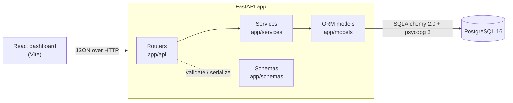

# Architecture

StockFlow is a modular monolith: one FastAPI process, one PostgreSQL database, and a React
dashboard that talks to the API over HTTP.



## Layers

| Layer | Location | Responsibility |
|---|---|---|
| Routers | `app/api/` | HTTP only: parse query params and headers, call one service function, pick the status code. No SQL, no business rules. |
| Schemas | `app/schemas/` | Pydantic v2 models for request validation (SKU normalization, money precision, quantity bounds) and response shape. |
| Services | `app/services/` | Business rules, and the **owners of transactions**. Each public function is one atomic unit (`with session.begin():`). |
| Models | `app/models/` | SQLAlchemy ORM mappings and the constraint names that services recognize in `IntegrityError`s. |
| Database | `app/database/connection.py` | Engine, connection pool, and the `get_session` dependency (one session per request). |
| Core | `app/core/` | Settings from environment variables, the error types, and the single JSON error format. |
| Migrations | `migrations/` | Hand-written Alembic revisions: tables, `CHECK`s, indexes, and the append-only trigger. |

```text
app/
  api/          routers: products, inventory, orders, reports
  services/     product, inventory, order and report services
  models/       Product, Inventory, Order, OrderItem, StockMovement
  schemas/      Pydantic request/response models
  database/     engine, per-request session
  core/         settings, error types and handlers
migrations/     Alembic revisions
frontend/       React dashboard
tests/          unit/ integration/ concurrency/
scripts/        seed.py
```

Errors raised in services (`NotFoundError`, `ConflictError`, `BusinessRuleError`) are mapped to
`404/409/400` by one exception handler, so every error response has the same shape:

```json
{"error": {"code": "INSUFFICIENT_STOCK", "message": "Insufficient stock for: DSK-STAND-140",
           "details": {"shortages": [{"product_id": 13, "sku": "DSK-STAND-140", "requested": 5, "available": 1}]}}}
```

## Order creation, step by step

`order_service.create_order` (`app/services/order_service.py`):

1. **Reject duplicate product IDs** (`400 DUPLICATE_ORDER_ITEM`) and compute the canonical request
   hash.
2. **Idempotency fast path.** If an `Idempotency-Key` was sent and an order already has it, return
   that order (`200`) when the hash matches, or `409 IDEMPOTENCY_KEY_REUSED` when it does not.
3. **`BEGIN`** (one transaction from here to commit).
4. **Load products** in one query. Missing → `404`, inactive → `400`.
5. **Capture prices and compute the total** in `Decimal` from the current `products.price`.
6. **`INSERT` the order and flush.** This claims the idempotency key now: a concurrent duplicate
   blocks on the unique index here, before touching inventory.
7. **Lock inventory rows**: `SELECT … WHERE product_id IN (…) ORDER BY product_id FOR UPDATE`.
8. **Check every line** against the locked quantities. Any shortage raises `409 INSUFFICIENT_STOCK`
   listing *all* short products, and the transaction rolls back.
9. **`INSERT` order items** with the captured `unit_price`.
10. **Decrement inventory and `INSERT` one `PURCHASE` movement per item** (with `order_id` and
    `resulting_quantity`).
11. **`COMMIT`.** If anything raised in steps 4–10, the context manager rolls back and no order,
    item, stock change or movement survives (`tests/integration/test_transactions.py`).
12. **On `IntegrityError` for `uq_orders_idempotency_key`**, another request with the same key won
    the race: reload its order and apply the step 2 rules.

The database adds a second line of defence: `CHECK (quantity >= 0)` on `inventory` makes overselling
impossible even if a code path skipped the check.

## Locking strategy and why it cannot deadlock

Every write path takes inventory locks through one function, `inventory_service.lock_inventory_rows`,
which always locks in ascending `product_id` order:

| Operation | Locks taken, in order |
|---|---|
| Create order | (own new order row) → inventory rows ascending |
| Cancel order | that order row → inventory rows ascending |
| Adjust / restock | one inventory row |

A deadlock needs a cycle: transaction A holds lock X and waits for Y while B holds Y and waits for
X. If all transactions acquire inventory locks in the same total order, then whenever A waits for B,
B holds only locks that come *before* the one A wants, so it never waits for one A holds. No cycle
can form. Order creation never locks existing order rows, so the cancellation prefix (order row
first) does not create a cycle either.

PostgreSQL locks rows as they leave the sort node, so `ORDER BY product_id … FOR UPDATE` really does
acquire them in order. Under `READ COMMITTED`, a transaction that waited for a lock re-reads the
row's newly committed version before returning it, so the stock check always sees the latest
quantity. `populate_existing` also stops SQLAlchemy from reusing a stale in-session copy.

## Idempotency under concurrency

A read-then-insert check alone has a race: two requests can both read "no order with key K". The
unique constraint closes it:

1. Requests A and B (same key K) both miss the fast path and begin transactions.
2. A `INSERT`s its order with key K. B's `INSERT` of K **blocks** on A's uncommitted index entry.
   At this point B holds no inventory locks, because the order is inserted before inventory is
   locked.
3. A locks inventory, writes items and movements, and commits.
4. B's `INSERT` now fails with a unique violation. B's transaction rolls back (it changed nothing),
   then B reads A's order in a new transaction and returns it (`200`), or `409` if B's body hash
   differs.

If A fails instead (for example insufficient stock), it rolls back and releases the key, and B
proceeds as a normal first attempt. `test_20_concurrent_requests_with_one_idempotency_key_create_one_order`
fires 20 identical requests at once and asserts exactly one `201`, nineteen `200`s, one order, and
one stock decrement.

## Cancellation is exactly-once

`cancel_order` begins with `SELECT … FROM orders WHERE id = :id FOR UPDATE`. With 20 simultaneous
cancellations:

- One transaction gets the row lock, restores each item's quantity (locking inventory in ascending
  order), writes a `CANCELLATION` movement per item, sets `status = 'CANCELLED'`, and commits.
- The other 19 were blocked on the same row lock. Each wakes up with the committed row, sees
  `CANCELLED`, and returns `409 ORDER_ALREADY_CANCELLED`, having changed nothing.

Stock is restored once because the status check and the restore happen under the same lock, in the
same transaction. `test_20_concurrent_cancellations_restore_stock_exactly_once` asserts one `200`,
nineteen `409`s, and exactly one `CANCELLATION` movement per item.

## The ledger invariant

`stock_movements` is an append-only ledger (a trigger rejects `UPDATE` and `DELETE`). Inventory
starts at 0, and every change writes a movement in the same transaction, so at all times:

```
inventory.quantity == SUM(stock_movements.change_quantity)   -- per product
```

Ordered by `id`, each movement's `resulting_quantity` also equals the running sum up to that row.
Movement IDs are assigned while the row lock is held, so ID order matches the order the changes were
applied. The concurrency suite checks both properties after every test
(`tests/helpers.py::assert_inventory_matches_movements`).

## Frontend

`frontend/src` contains four tab pages (Dashboard, Products, Inventory, Orders), a tiny `api.js`
client that converts error responses into an `ApiError(code, message, details)`, and a notice stack
that shows every API error with its code and details, such as the per-product shortage list. Data
loading uses a small `useApi` hook. There is no global state library.

## Known limitations

- No authentication or roles (out of scope), so idempotency keys are global rather than per client.
- Offset pagination; keyset pagination would suit very large movement histories better.
- Single warehouse, no payments or shipping, by design.
- The Compose frontend runs the Vite dev server rather than a production static build.
